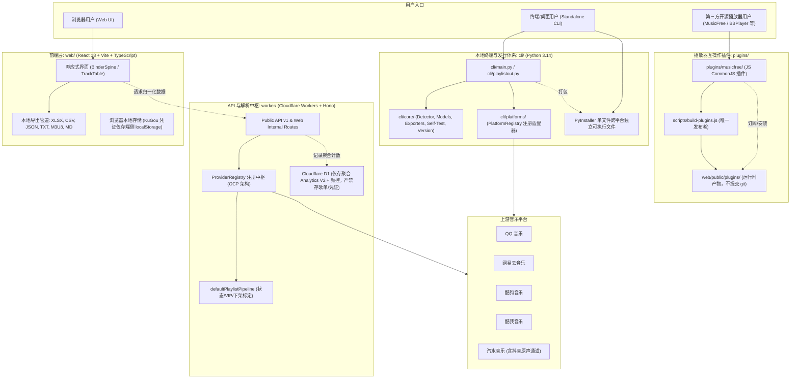
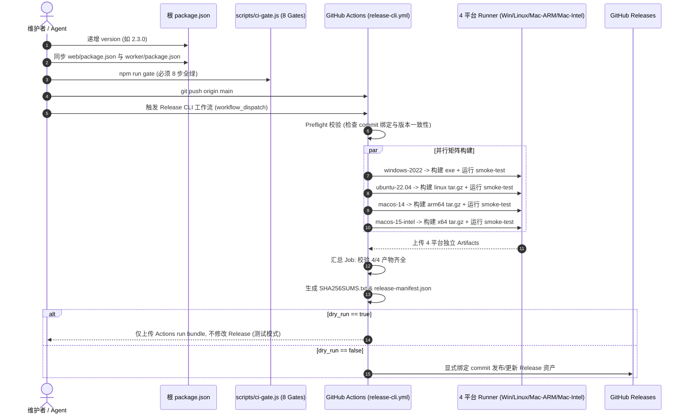
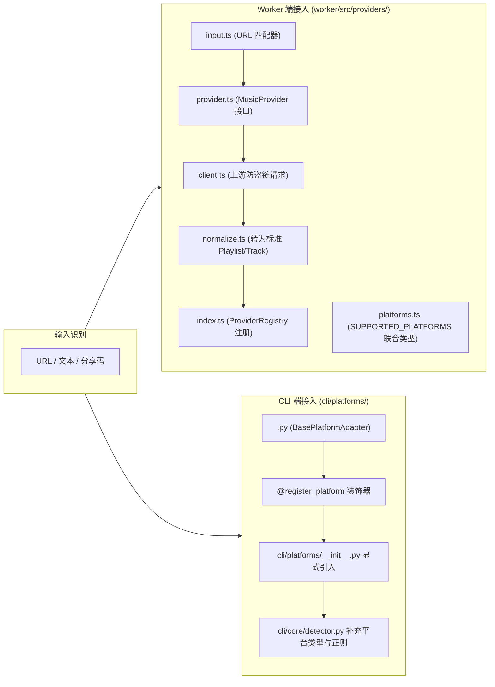

# PlaylistOut 全景系统架构与 AI 协作规范 (System Architecture & Agent Guide)

本文档是为 AI Agent 与人类开发者提供的 PlaylistOut 全景技术架构全景说明书。  
在进行任何代码修改、功能扩展、CLI 维护或发版操作前，必须通读并严格遵守本规范。

---

## 1. 全景架构与分层心智模型 (Repository Mental Model)

PlaylistOut 是一个轻量级、去中心化、隐私优先的音乐歌单导出与跨播放器互操作单体代码仓库（Monorepo）。  
核心产品哲学为：**Paste. Parse. Export. Keep moving.**（粘贴、解析、导出、不留痕迹）。



### 核心宪法红线 (Non-negotiable Rules)
1. **严禁服务端抓取或转发音频流/歌词**：PlaylistOut 只做歌单元数据结构化与备份。
2. **严禁任意开放代理**：Worker 请求必须使用平台专属白名单域名与严格的参数校验，绝不提供 `/proxy?url=...` 通用代理。
3. **导出留在端侧**：Worker 只输出标准 JSON 数据；XLSX/CSV/TXT/JSON/M3U8 生成完全由浏览器端或本地 CLI 完成。
4. **隐私边界**：严禁持久化存储任何用户歌单 URL、歌单 ID、歌曲列表、QQ 号、Cookie 或第三方 Token 到服务器 D1 数据库。

---

## 2. 本地 CLI 运行与开发规范 (Local CLI Architecture)

本地 Python CLI 是第一等公民的独立工具，具有 100% 本地隐私安全。

### 2.1 双轨交互模式
Unified CLI（`cli/main.py` / `cli/playlistout.py`）支持双轨交互体验：
- **终端交互模式 (无参数直接启动)**：
  - 双击 Windows `.exe` 或终端运行 `python cli/main.py`。
  - 显示线框 ANSI Banner 与主菜单。
  - 用户可直接粘贴长链接、短链或分享文案（通过 `SmartDetector` 自动消歧识别平台），或输入 `1-5` 锁定目标平台。
- **命令行参数模式 (自动化/批处理)**：
  - 终端传参：`PlaylistOut.exe "<url>" -p qqmusic -f xlsx,csv -o ./output --no-open`
  - 出现错误时，输出清晰的 `stderr` 并返回非零 exit code，绝不挂起等待回车。

### 2.2 依赖体系三层分立
- **运行时依赖 (`cli/requirements.txt`)**：
  - 仅包含真正运行 CLI 所需最小依赖：`requests>=2.28.0` 与 `openpyxl>=3.0.0`。
  - 严禁加入 pytest 等测试工具。
- **开发与测试依赖 (`cli/requirements-dev.txt`)**：
  - `-r requirements.txt`、`pytest>=7.0.0`、`pyinstaller==6.22.3`。
- **发布构建锁定约束 (`cli/requirements-release.txt`)**：
  - 锁定经过生产验证的具体 patch：`requests==2.34.2`、`openpyxl==3.1.5`、`certifi==2026.7.22`、`pyinstaller==6.22.3` 等，保证重复构建幂等、零漂移。

### 2.3 版本单一源头真理 (`cli/core/version.py`)
- 根目录 `package.json#version` 是全仓版本的 **Single Source of Truth**。
- `cli/core/version.py` 在源码运行时向上查找根目录 `package.json` 获取版本。
- 在 PyInstaller 打包时，`package.json` 作为 data file 打入根目录，运行时从 `sys._MEIPASS/package.json` 获取版本。
- **Fail-Closed 规则**：在打包或正式校验中，如果版本元数据缺失或无法读取，必须直接抛出异常终止运行，**绝对禁止静默 fallback 为硬编码假版本**。

### 2.4 确定性离线自检 (`cli/core/self_test.py`)
- 运行命令：`python cli/main.py --self-test`（参数在 `--help` 中通过 `argparse.SUPPRESS` 隐藏）。
- **零网络依赖**：使用合成歌单在临时目录测试 XLSX（`Tracks` 与 `Playlist Info` 工作表回读）、CSV（UTF-8 BOM）、JSON（Canonical 契约）、TXT、M3U8 的生成与内容完整性。
- 保证 5 个内置平台适配器全部注册，CA 证书路径可读。

### 2.5 本地打包与构建边界
- 打包入口脚本：`python scripts/release/build-cli.py --target <target>`。
- **构建工作区隔离**：临时文件只准写入 `.build/cli/`，产物只准写入 `dist/cli/`。**严禁清理或删除 monorepo 通用的根 `build/` 或 `dist/`**。

---

## 3. 发行体系与发布操作指南 (Release & Publishing Architecture)

发行系统实现了全自动、确定性、无需维护者自备 macOS/Linux 物理机的跨平台 CI 发行。



### 3.1 跨平台支持矩阵
| 平台 / 架构 | 资产文件名 | GitHub Runner | 说明 |
|---|---|---|---|
| **Windows x64** | `PlaylistOut-v{version}-windows-x64.exe` | `windows-2022` | Console 单文件，双击或终端传参 |
| **Linux x64** | `PlaylistOut-v{version}-linux-x64.tar.gz` | `ubuntu-22.04` | 保持老版本 Ubuntu 降低 glibc 依赖 |
| **macOS Apple Silicon** | `PlaylistOut-v{version}-macos-arm64.tar.gz` | `macos-14` | 内置 `PlaylistOut` 与 `PlaylistOut.command` |
| **macOS Intel** | `PlaylistOut-v{version}-macos-x64.tar.gz` | `macos-15-intel` | 内置 `PlaylistOut` 与 `PlaylistOut.command` |

### 3.2 发行操作流水线 (Standard Operating Procedure)

1. **版本号更新**：
   - 修改根目录 `package.json#version`。
   - 同步修改 `web/package.json#version` 与 `worker/package.json#version`。
   - 运行单元测试验证一致性：`python -m pytest cli/tests/test_version.py`。
2. **本地全量门禁**：
   - 运行 `npm run gate`，确保 8 步全部通过（工作流安全语法、密钥扫描、依赖边界、Python 测试与自检、TS 检查、Web 构建、Worker 构建、D1 迁移）。
3. **提交与推送**：
   - 提交信息遵循 Conventional Commits：`git commit -m "chore(release): bump version to x.y.z"`
   - 推送至 `main`：`git push origin main`。
4. **触发 Release 工作流**：
   - 在 GitHub Actions UI 打开 **Release CLI** 工作流。
   - 点击 **Run workflow**：
     - 若只想验证跨平台打包：勾选 `dry_run: true`（不触碰 GitHub Releases）。
     - 若正式发版：设置 `dry_run: false`。
5. **原子性与安全性保障**：
   - 工作流并发锁设置 `cancel-in-progress: false`，防止上传中断导致残缺 Release。
   - `preflight` 会比对已有 Git Tag：如果 Tag 已存在且指向不同 Commit，工作流立即强行终止，严禁篡改历史发版。
   - 最终 Release 必须在 4 个平台的 `--version`、`--self-test`、`--help` 真实冒烟全部成功后才执行归集与上传。

---

## 4. 新厂商接入扩展指南 (Vendor Onboarding Architecture)

新增一个音乐平台厂商时，必须在 Worker 端与 CLI 端同时接入，保持模型与行为对齐。



### 4.1 Worker 端接入（5 步走）
1. 在 `worker/src/providers/<vendor-id>/` 创建标准子模块：
   - `input.ts`：输入校验、正则提取。
   - `client.ts`：请求上游官方接口（严格只请求白名单域名，带防盗链 header，有重试与超时控制）。
   - `normalize.ts`：将原始响应转为统一的 `Playlist` / `Track` 接口模型。
   - `provider.ts`：实现 `MusicProvider` 接口，声明 `ProviderMeta` 与 `ProviderCapabilities`。
   - `index.ts`：导出实例。
2. 在 `worker/src/providers/index.ts` 中注册：
   ```typescript
   import { vendorProvider } from './<vendor-id>';
   providerRegistry.register(vendorProvider);
   ```
3. 在 `worker/src/providers/platforms.ts` 中将 `<vendor-id>` 追加到 `SUPPORTED_PLATFORMS`。
4. 编写提供商测试：`worker/src/providers/<vendor-id>/<vendor-id>.test.ts`。
5. **无需修改**任何路由、解析服务或数据管道（`defaultPlaylistPipeline` 会自动标定该厂商的歌曲状态）。

### 4.2 CLI 端接入（4 步走）
1. 在 `cli/platforms/<vendor_id>.py` 创建适配器类：
   ```python
   from .base import BasePlatformAdapter
   from .registry import register_platform
   from ..core.models import NormalizedPlaylist, NormalizedTrack

   @register_platform
   class VendorAdapter(BasePlatformAdapter):
       platform_id = "vendor_id"
       display_name = "厂商中文名"
       description = "特性简述"
       aliases = ["vendor", "v"]

       def can_handle(self, text: str) -> bool:
           return "vendor.com" in text.lower()

       def fetch_playlist(self, raw_input: str, **options) -> Optional[NormalizedPlaylist]:
           # 解析并返回标准 NormalizedPlaylist
           ...
   ```
2. 在 `cli/platforms/__init__.py` 显式导入该模块（确保 PyInstaller 静态依赖图追踪到）。
3. 在 `cli/core/detector.py` 的 `PlatformType` 枚举与 `SmartDetector.detect()` 中添加域名正则。
4. 在 `cli/core/self_test.py` 的 `required_platforms` 列表中加入新厂商 ID。
5. 运行自检与测试：
   ```bash
   python -m pytest cli/tests/
   python cli/main.py --self-test
   ```

### 4.3 播放器生态插件适配 (若适用)
如果需要在 MusicFree 等第三方播放器中同步支持新平台：
- 参考 `.agents/rules/plugin-architecture.md` 与 `.agents/skills/player-plugins/SKILL.md`。
- 在 `plugins/<player-id>/` 维护独立插件源码与测试。
- 绝不手工触碰 `web/public/plugins/`，由 `scripts/build-plugins.js` 自动发现并发布。

---

## 5. AI Agent 协作自检清单 (Pre-Flight Checklist for Agents)

在声称任何开发任务完成或发起提交前，AI Agent 必须在内心核对以下准则：

- [ ] **没有破坏核心宪法**：没有在 Worker 中使用 Node 运行时库，没有引入服务端音频下载，没有将用户凭证或歌单存入 D1。
- [ ] **没有破坏版本一致性**：`package.json`、`web/package.json`、`worker/package.json` 版本一致，`test_version.py` 通过。
- [ ] **没有硬编码 CLI 版本**：CLI 严格通过 `cli/core/version.py` 动态读取，且打包缺失时严格 fail-closed。
- [ ] **没有遗留构建垃圾**：构建清理严格限制在 `.build/cli/` 与 `dist/cli/`，没有生成悬挂的 spec 或临时 pyc。
- [ ] **运行全量门禁**：本地执行 `npm run gate`，确认 8 项检查 100% 绿灯。
- [ ] **真实查看 GitHub Actions**：Push 之后观察远程工作流真实运行日志，严禁仅凭本地推测声称跨平台通过。
